# goit-rdb-fp — Фінальний проєкт з реляційних баз даних

Аналіз датасету `infectious_cases` (статистика інфекційних захворювань за країнами та роками) у **PostgreSQL 16**.

## Структура репозиторію

| Шлях | Опис |
|---|---|
| [`sql/final_project.sql`](sql/final_project.sql) | Увесь SQL-код проєкту (завдання 1–5) |
| [`data/infectious_cases.csv`](data/infectious_cases.csv) | Вхідний датасет (10 521 рядок) |
| [`screenshots/`](screenshots/) | Скриншоти таблиць, запитів і результатів |

## Як запустити

```bash
# з кореня репозиторію
psql -d <database> -f sql/final_project.sql
```

Скрипт ідемпотентний: перестворює таблиці та функції при повторному запуску. Імпорт виконується командою `\copy`, тому шлях `data/infectious_cases.csv` рахується від поточної директорії.

## Виконання завдань

### 1. Завантаження даних

- Створено схему `pandemic` і встановлено її схемою за замовчуванням (`SET search_path TO pandemic`).
- Створено таблицю `infectious_cases` за структурою CSV та імпортовано дані через `\copy` (10 521 рядок).
- Порожні значення в CSV — це порожні рядки, тому показники захворювань у сирій таблиці зберігаються як `TEXT` (`FORCE_NOT_NULL` залишає їх як `''`).

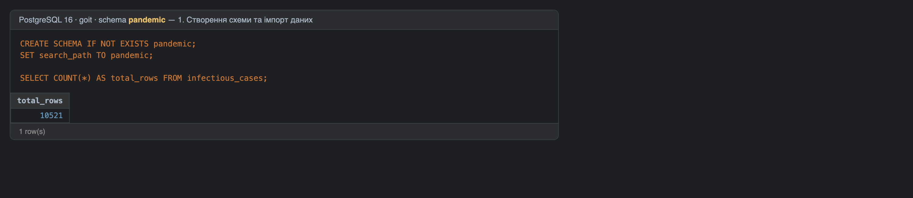
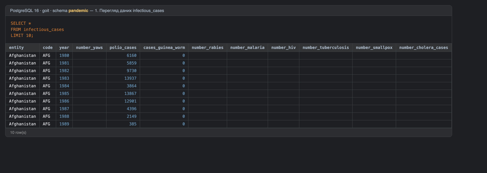

### 2. Нормалізація до 3НФ

У сирій таблиці `code` залежить від `entity`, а не від ключа (`entity`, `year`). Це транзитивна залежність, яка порушує 3НФ. Таблицю розбито на дві:

- **`entities`** (`id`, `entity`, `code`): 245 унікальних комбінацій Entity + Code. Для регіонів і груп країн без ISO-коду `code = NULL`.
- **`infectious_cases_normalized`** (`id`, `entity_id` → `entities.id`, `year`, показники): 10 521 рядок. Показники перетворено на `NUMERIC`, а порожні значення на `NULL`. Додано обмеження `UNIQUE (entity_id, year)`.

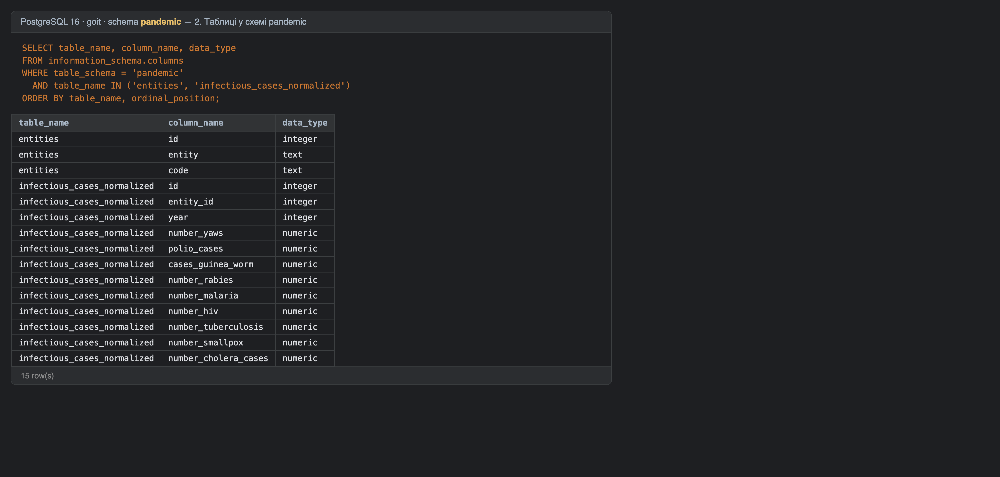
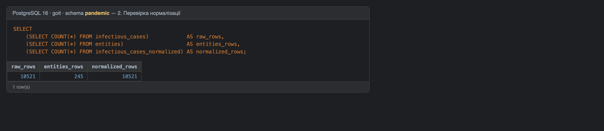
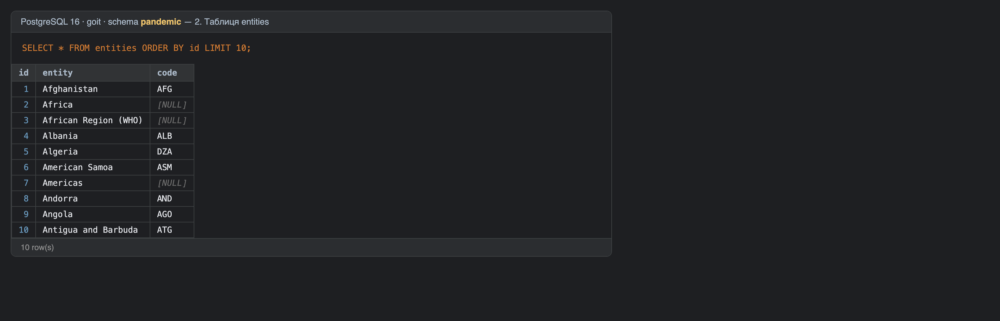
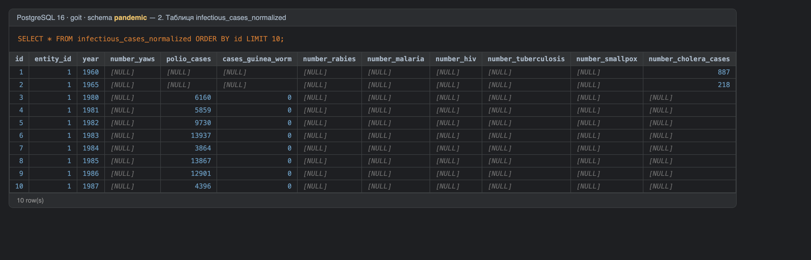

### 3. Аналіз `Number_rabies`

Для кожної пари `entity`/`code` (через `id`) пораховано `AVG`, `MIN`, `MAX` і `SUM` для `number_rabies`. Порожні значення відкинуто. Результат відсортовано за середнім значенням за спаданням і обмежено 10 рядками.

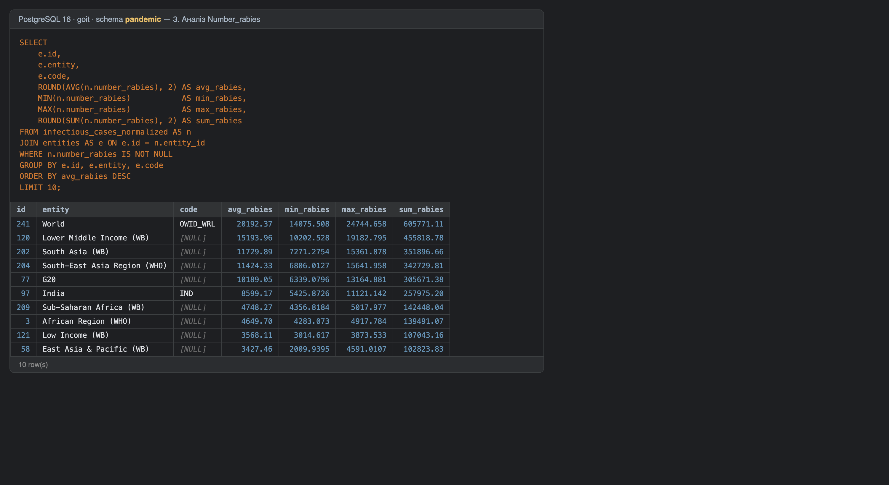

### 4. Колонка різниці в роках

Використано вбудовані функції:
- `MAKE_DATE(year, 1, 1)` — дата 1 січня відповідного року;
- `CURRENT_DATE` — поточна дата;
- `EXTRACT(YEAR FROM AGE(CURRENT_DATE, MAKE_DATE(year, 1, 1)))` — різниця в повних роках.

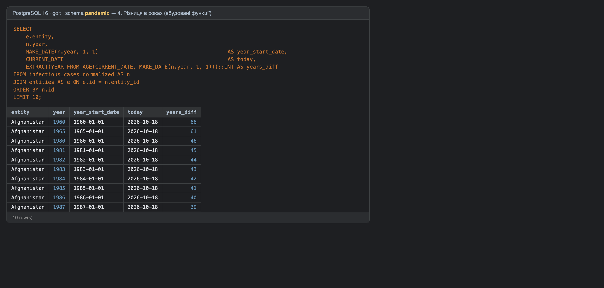

### 5. Власні функції

- **`fn_years_diff(p_year INTEGER) → INTEGER`** повертає різницю в роках між поточною датою та 1 січня заданого року (наприклад, `1996 → 1996-01-01 → 30` станом на 2026-10-18).
- **`fn_avg_cases_per_period(p_cases_per_year NUMERIC, p_divider NUMERIC) → NUMERIC`** повертає середню кількість захворювань за період (річна кількість / дільник, округлено до 2 знаків). Якщо дільник дорівнює 0, функція повертає `NULL`.

Другу функцію перевірено з дільниками 12 (місяць), 4 (квартал) і 2 (півріччя). Запит бере лише записи, у яких `number_rabies` є числом: це перевіряє регулярний вираз `'^-?[0-9]+(\.[0-9]+)?$'`.

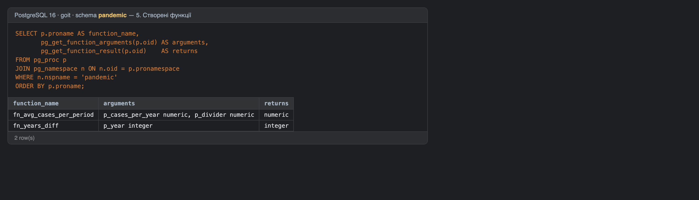
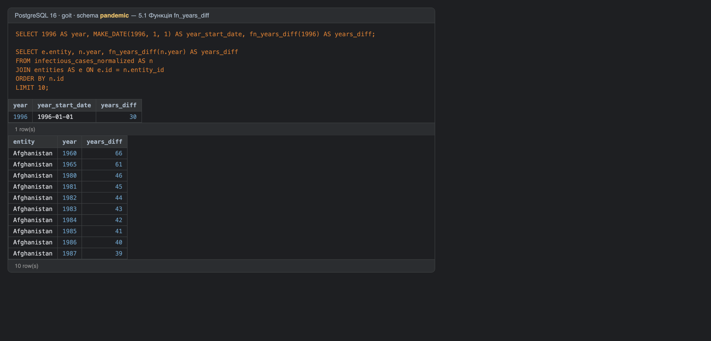
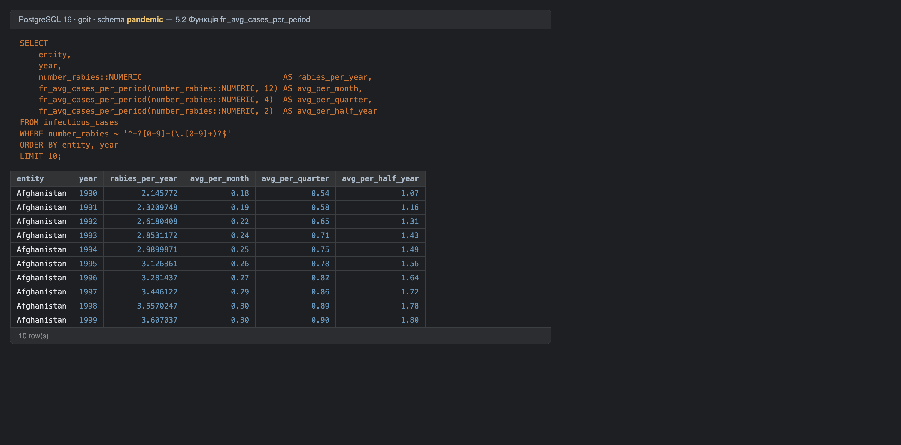
